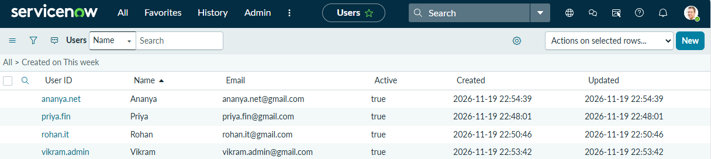
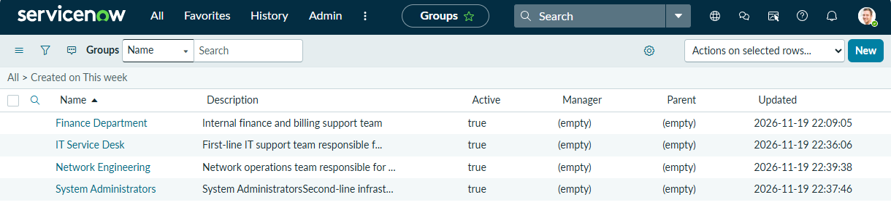
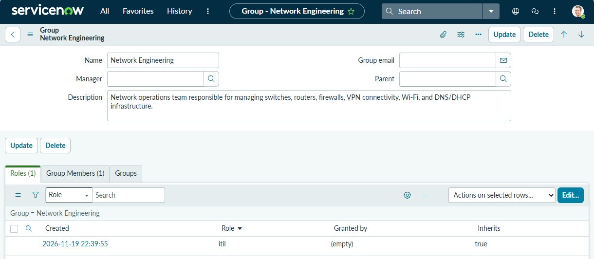
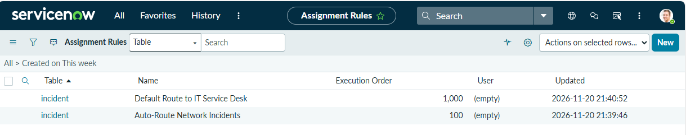
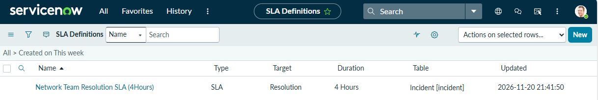
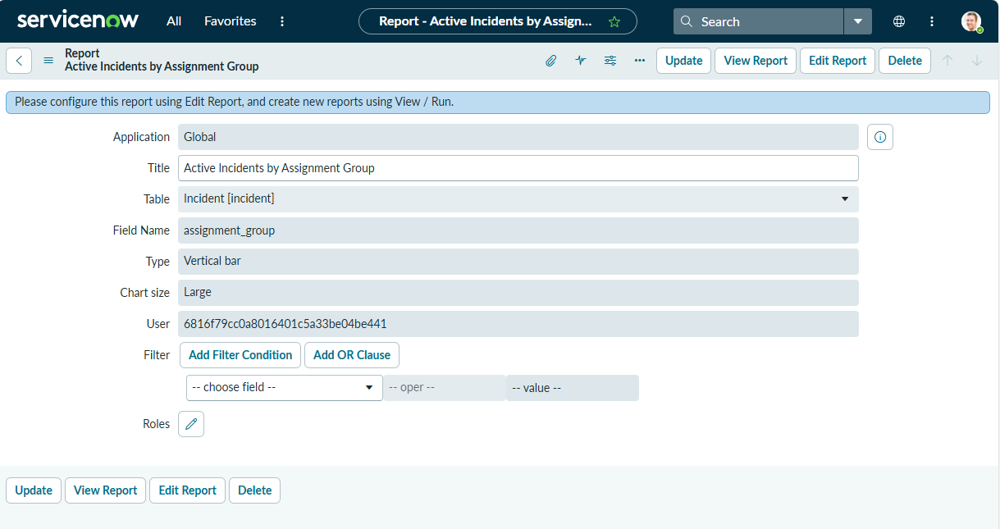

# ServiceNow ITSM: Automated Incident Management & SLA Implementation

An end-to-end IT Service Management (ITSM) administration project built in a ServiceNow Personal Developer Instance (PDI). This project demonstrates Role-Based Access Control (RBAC), multi-tier incident triage and escalation, automated ticket routing via Assignment Rules, custom SLA tracking, and operational reporting.

---

## Architecture & Access Control (RBAC)

Implemented a least-privilege access model using **group-based role inheritance** rather than direct user role assignments. Three IT support groups inherit the `itil` role through group membership, while the Finance requester group remains restricted to Self-Service modules.

| Assignment Group | Inherited Role | Test Persona | Functional Scope |
| :--- | :--- | :--- | :--- |
| **Finance Department** | *None (End User)* | `priya.fin` | Self-service incident submission & status tracking |
| **IT Service Desk** | `itil` | `rohan.it` | Tier 1 initial triage, work-note documentation, & escalation |
| **System Administrators** | `itil` | `vikram.admin` | Tier 2 server, OS, & infrastructure administration |
| **Network Engineering** | `itil` | `ananya.net` | Tier 2 network routing, firewall, & VPN resolution |

---

## Key Features Implemented

### 1. Multi-Tier Incident Lifecycle & Impersonation Validation
* **Requester (`priya.fin`):** Verified restricted UI visibility and submitted an end-user incident via Self-Service.
* **Tier 1 Triage (`rohan.it`):** Validated `itil` queue access, documented troubleshooting work notes, and escalated network-isolated tickets to Tier 2.
* **Tier 2 Resolution (`ananya.net`):** Accepted escalated queue work, documented root-cause resolution codes/notes, and resolved the incident.

### 2. Automated Ticket Routing (Assignment Rules)
* **Auto-Route Network Incidents:** Configured a rule on the `incident` table (`Category = Network`) to bypass manual Tier 1 triage and route directly to **Network Engineering**.
* **Default Route to IT Service Desk:** Configured a fallback assignment rule (`Assignment group is empty`) to automatically queue general inquiries and software/hardware tickets with **IT Service Desk**.

### 3. Service Level Management (SLAs)
* Built a custom **4-Hour Resolution SLA** (`Network Team Resolution SLA (4 Hours)`) triggered when active incidents are assigned to **Network Engineering**.
* Configured **Pause Conditions** (`State = On Hold`) to halt the SLA timer while awaiting user or vendor responses, and **Stop Conditions** (`State is one of Resolved, Closed`).

### 4. Operational Reporting
* Created a real-time bar chart report (**Active Incidents by Assignment Group**) on the `incident` table with data labels enabled to monitor active ticket distribution across functional teams, alongside an exported PDF report summary.

---

## Repository Contents

* [`update-sets/sys_remote_update_set_ddf92e7f8360571044605930ceaad320.xml`](update-sets/sys_remote_update_set_ddf92e7f8360571044605930ceaad320.xml) — Exported ServiceNow Update Set containing the Assignment Rules, custom SLA Definition, and Report metadata.
* [`docs/test-cases.md`](docs/test-cases.md) — End-to-end verification matrix covering RBAC, impersonation, routing, and SLA execution.
* [`screenshots/Report.pdf`](screenshots/Report.pdf) — Exported PDF report of active incidents grouped by Assignment Group.
* [`screenshots/`](screenshots/) — Visual walkthrough of the filtered ServiceNow configurations and test results.

---

## Visual Walkthrough

### 1. User Administration, Assignment Groups & `itil` Role Inheritance

### 2. Automated Ticket Routing (Assignment Rules)

### 3. Custom 4-Hour Resolution SLA Definition

### 4. Operational Reporting & Incident Verification

